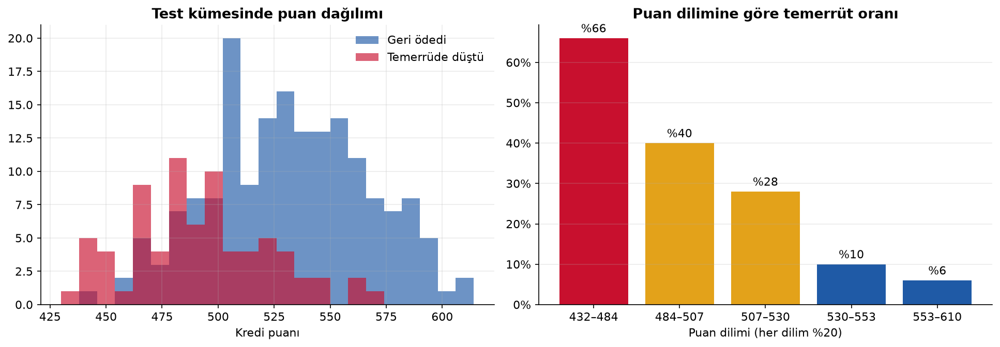
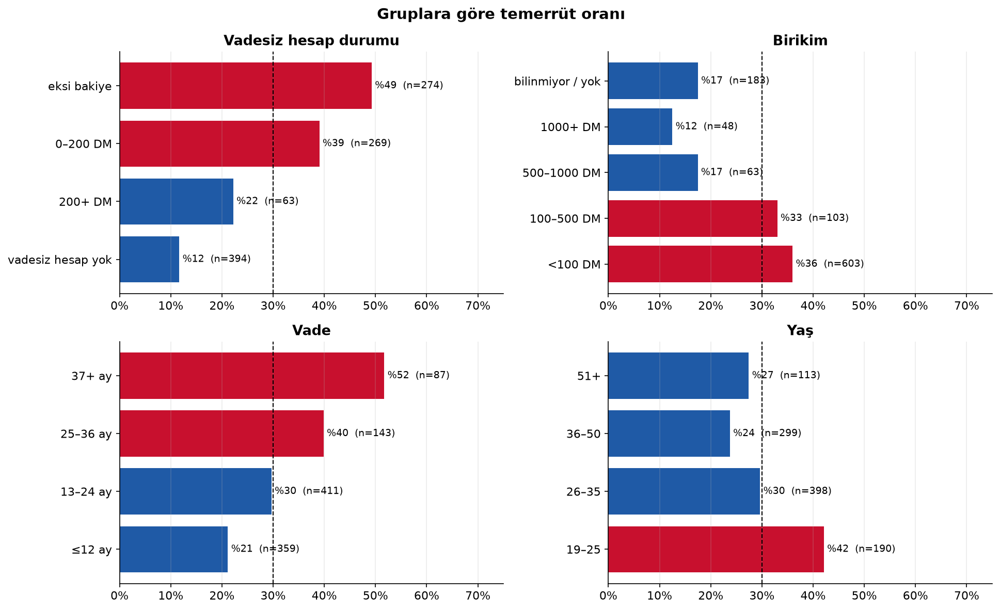
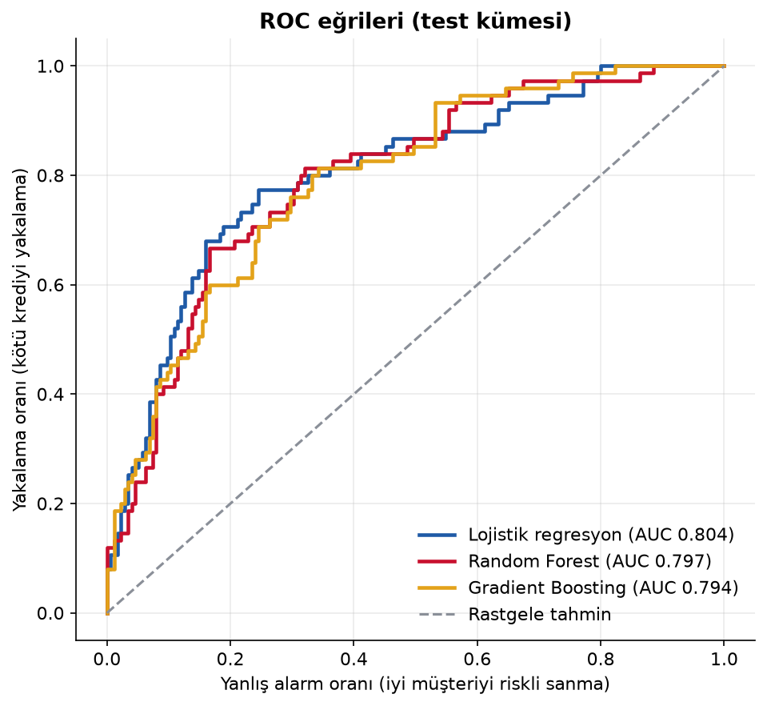
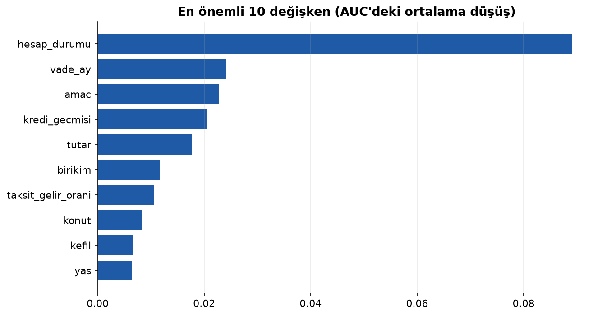

# 🏦 Kredi Skorlama Modeli


Bir kredi başvurusunun geri ödenip ödenmeyeceğini tahmin eden ve sonucu bankacılıkta kullanılan biçimde **kredi puanına** çeviren bir makine öğrenmesi projesi.

📓 **Analizin tamamı:** [`analiz.ipynb`](analiz.ipynb)

## Sonuçlar

| | Sonuç |
|---|---|
| En iyi model (test) | Lojistik regresyon: **AUC 0,804 · Gini 0,61 · KS 0,53** |
| Puan kartı (yorumlanabilir) | AUC 0,798 |
| En riskli %20 / en güvenli %20 | Temerrüt oranı **%66** / **%6** |
| Maliyet odaklı eşik | Başvuru başına beklenen kayıp **%25 daha düşük** |

### Kredi puanı riski ayırt ediyor


### Keşifsel analiz


### Model karşılaştırma
 

## Neler yapıldı?

1. **Keşifsel analiz:** Hesap durumu, birikim, vade ve yaşa göre temerrüt oranları.
2. **Üç model:** Lojistik regresyon, Random Forest ve Gradient Boosting. 5 katlı çapraz doğrulama ile seçildi, ayrı tutulan test kümesinde ölçüldü.
3. **Bankacılık metrikleri:** ROC-AUC, Gini ($2 \cdot AUC - 1$) ve Kolmogorov–Smirnov (KS).
4. **Maliyete duyarlı karar:** Kötü krediyi onaylamak, iyi müşteriyi reddetmekten 5 kat pahalı. Onay eşiği, beklenen maliyeti en aza indirecek şekilde çapraz doğrulama tahminleriyle seçildi.

$$\text{Maliyet}(e) = 5 \cdot FN(e) + 1 \cdot FP(e)$$

5. **Puan kartı (scorecard):** Lojistik regresyon, PDO = 20 ve "600 puan = 50:1 iyi/kötü oranı" ölçeğiyle puanlara çevrildi.

$$\text{Puan} = \text{offset} + \frac{20}{\ln 2} \cdot \ln(\text{oran}_{iyi})$$

6. **Açıklanabilirlik:** Permütasyon önemi ile modelin hangi değişkenlere dayandığı.

## Etik tercih

Veride **cinsiyet/medeni durum** ve **yabancı çalışan** bilgisi var. Bu değişkenler ayrımcılık riski taşıdığı ve birçok ülkede kredi kararında kullanılması yasak olduğu için **modele alınmadı**.

## Veri

[UCI Statlog (German Credit Data)](https://doi.org/10.24432/C5NC77): 1.000 başvuru, 20 özellik, %30 temerrüt. Lisans CC BY 4.0. Kod tabloları `src/veri.py` içinde Türkçeye çevrildi.

## Çalıştırma

```bash
pip install -r requirements.txt
jupyter notebook analiz.ipynb
```

## Sınırlılıklar

- Veri küçük ve eski. Yöntem genellenebilir, katsayılar genellenemez.
- Yalnızca onaylanan başvuruların sonucu biliniyor (*reject inference* problemi).
- Maliyet tablosu iyi kredilerden elde edilen faiz gelirini hesaba katmıyor. Kâr odaklı bir hedefte eşik yukarı kayar.

---

**Mehmet Vural** · Matematik Öğretmeni · Veri Bilimi & Finans · [LinkedIn](https://www.linkedin.com/in/mehmetvrl/)
